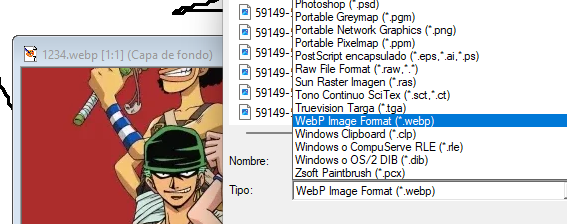

# PSP7-WebP

**Native WebP support for Paint Shop Pro 7.04**

Open and save [WebP](https://developers.google.com/speed/webp) images directly in Jasc Paint Shop Pro 7.04



## Quick Install (prebuilt)

1. Go to the PSP 7 installation directory (where `psp.exe` lives)
2. Rename the original `jff.dll` to `jff_orig.dll`
3. Copy the provided `jff.dll` into the same directory
4. Launch Paint Shop Pro — WebP now appears in Open/Save dialogs

To uninstall, delete the proxy `jff.dll` and rename `jff_orig.dll` back to `jff.dll`.

## How it works

This project creates a **proxy DLL** that replaces `jff.dll` — PSP 7's image format library. The proxy:

- Forwards all 178 original exports transparently to the renamed `jff_orig.dll`
- Intercepts 6 functions to inject WebP read/write support:
  - `DecodeIFF` / `EncodeIFF` — read and write image data
  - `ImageTypeByFilename` / `ImageTypeByJFile` — file type detection
  - `LoadJFFFilterString` / `LoadJFFFileIDString` — UI filter strings

The rarely-used **IFF (Amiga)** format slot is repurposed for WebP. All other image formats (BMP, JPEG, PNG, GIF, TIFF, PSD, etc.) continue working normally through the original DLL.

### Decode flow

1. PSP calls `DecodeIFF` for the intercepted format
2. The proxy reads the `.webp` file directly from disk
3. [libwebp](https://developers.google.com/speed/webp/docs/api) decodes the WebP data to RGBA pixels
4. Pixels are converted to an in-memory BMP
5. The BMP is passed to PSP's internal `DecodeBMP` via a `CJFileMemory` object

### Encode flow

1. PSP calls `EncodeIFF` when saving as `.webp`
2. The proxy redirects to `EncodeBMP`, which writes a BMP to disk
3. The BMP file is read back, pixels extracted and converted to RGBA
4. libwebp encodes the RGBA data to WebP (lossy, quality 85)
5. The file is overwritten with the WebP data

## Build from source

### Requirements

- **Windows** (32-bit output required)
- **Visual Studio 2019 or 2022** with "Desktop development with C++" workload (x86 tools)
- **PowerShell 5.1+**
- Internet connection (to download libwebp on first build)

### Steps

```powershell
git clone https://github.com/trankten/psp7_webp.git
cd psp7_webp
.\build.ps1
```

The build script will:
1. Auto-detect Visual Studio
2. Download [libwebp 1.0.3](https://storage.googleapis.com/downloads.webmproject.org/releases/webp/libwebp-1.0.3-windows-x86.zip) (x86) if not present
3. Generate the export forwarding table (`jff_proxy.def`)
4. Compile `jff.dll` — the output is in `build\jff.dll`

### Debug logging

To enable diagnostic logging, compile with `/D ENABLE_LOG=1`. The proxy will write to `jff_proxy.log` in the PSP directory.

## Compatibility

| Software | Version | Status |
|----------|---------|--------|
| Paint Shop Pro | 7.04 | Tested and working |
| Paint Shop Pro | 7.00–7.03 | Should work (same DLL interface) |
| Paint Shop Pro | 8+ | Not tested (different DLL structure) |

## Limitations

- The IFF (Amiga ILBM) format is no longer available through the Open/Save dialog. If you need IFF support, you can rename the `.iff` file and open it via another tool.
- WebP encoding uses lossy compression at quality 85. Lossless encoding is not currently exposed.
- WebP images with alpha channels are decoded to 24-bit RGB (alpha is discarded during BMP conversion).
- Maximum file size: 100 MB.

## Roadmap

- [ ] Alpha channel support (preserve transparency on decode/encode)
- [ ] Configurable compression quality
- [ ] Lossless WebP encoding option
- [ ] WebP metadata preservation (EXIF, ICC profiles)

## Project structure

```
psp7-webp/
├── build.ps1          # Build script (downloads deps, compiles, links)
├── src/
│   └── jff_proxy.cpp  # Proxy DLL source (single file, ~400 lines)
├── build/             # Build output (generated)
│   └── jff.dll        # The proxy DLL
├── lib/               # libwebp static library (auto-downloaded)
├── include/           # libwebp headers (auto-downloaded)
├── screenshot.png     # Screenshot
├── LICENSE            # MIT License
└── README.md
```

## Legal notice

This project is an **independent, third-party enhancement** for Paint Shop Pro 7, a product originally developed by Jasc Software, later acquired by Corel Corporation.

**This project does not contain, distribute, or modify any proprietary code** from Paint Shop Pro or Jasc Software. The proxy DLL is original code that communicates with the unmodified original DLL through its documented public export interface. No reverse engineering of proprietary code was performed beyond identifying the public function signatures necessary for compatibility.

Paint Shop Pro 7 (released 2000) is widely considered [abandonware](https://en.wikipedia.org/wiki/Abandonware) — it is no longer sold, updated, or supported by its rights holders. This plugin requires a legitimately obtained copy of PSP 7 to function.

The WebP codec is provided by Google's [libwebp](https://chromium.googlesource.com/webm/libwebp/), licensed under the BSD 3-Clause License.

**Trademark notice:** "Paint Shop Pro" and "Jasc" are trademarks of their respective owners. This project is not affiliated with, endorsed by, or associated with Jasc Software or Corel Corporation.

## License

This project is released under the [MIT License](LICENSE).

The bundled libwebp library is licensed under the [BSD 3-Clause License](https://chromium.googlesource.com/webm/libwebp/+/refs/heads/main/COPYING).
