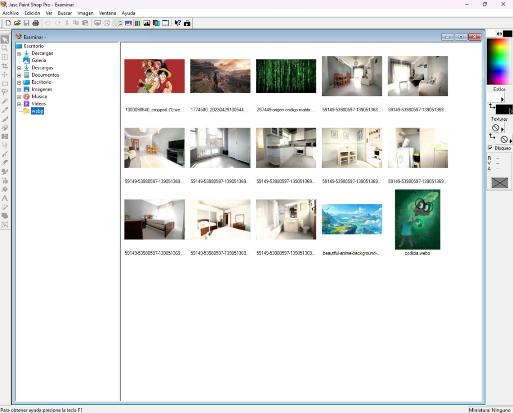

# PSP7-WebP

**Native WebP support for Paint Shop Pro 7.04**

Open and save [WebP](https://developers.google.com/speed/webp) images directly in Jasc Paint Shop Pro 7.04 — with full alpha channel support on read and experimental alpha preservation on write.


## Why this project?

In 2026, Jasc Paint Shop Pro 7 — originally released in 2001 — remains a remarkably capable image editing and management tool for Windows. It runs flawlessly on the latest versions of Windows 11, and its lightweight, fast interface still holds up against modern alternatives.

I grew up with this application. It was my go-to tool for everything from photo editing to batch processing. But as the web moved to newer formats like WebP, PSP 7 was left behind — Jasc Software was acquired by Corel, and version 7 was never updated again. Every time I downloaded a WebP image, I had to convert it in another program before opening it in PSP.

This project fixes that. If anyone out there is still using Jasc Paint Shop Pro 7.04 (and I suspect some of us are), this plugin gives it native WebP support — no external converters needed.



## Features

- **Open WebP images** — including images with alpha (transparency) channels
- **Save as WebP** — lossless or lossy, with configurable quality
- **Alpha channel support** — full transparency on read; experimental preservation on write via "Save As"
- **Options dialog** — configure compression mode, quality, and alpha settings when saving
- **Browser thumbnails** — WebP files display thumbnails in PSP's built-in Browser window
- **Settings persistence** — your preferences are saved across sessions

## Quick Install (prebuilt)

1. Go to the PSP 7 installation directory (where `psp.exe` lives)
2. Rename the original `jff.dll` to `jff_orig.dll`
3. Copy the provided `jff.dll` into the same directory
4. Launch Paint Shop Pro — WebP now appears in Open/Save dialogs

To uninstall, delete the proxy `jff.dll` and rename `jff_orig.dll` back to `jff.dll`.

## How it works

This project creates a **proxy DLL** that replaces `jff.dll` — PSP 7's image format library. The proxy:

- Forwards all 178 original exports transparently to the renamed `jff_orig.dll`
- Intercepts 10 functions to inject WebP read/write support:
  - `DecodeIFF` / `EncodeIFF` — read and write image data
  - `DecodePNG` / `EncodePNG` — used as intermediate codec for alpha support
  - `ImageTypeByFilename` / `ImageTypeByJFile` — file type detection
  - `LoadJFFFilterString` / `LoadJFFFileIDString` — UI filter strings
  - `LoadJFFFormatDesc` — format capabilities (reports PNG-like capabilities for alpha)

The rarely-used **IFF (Amiga)** format slot is repurposed for WebP. All other image formats (BMP, JPEG, PNG, GIF, TIFF, PSD, etc.) continue working normally through the original DLL.

The built-in **Browser** window also supports WebP — thumbnails are generated and displayed just like any other supported format.

### Decode flow

1. PSP calls `DecodeIFF` for the intercepted format
2. The proxy reads the `.webp` file directly from disk
3. [libwebp](https://developers.google.com/speed/webp/docs/api) decodes the WebP data to RGBA pixels
4. The alpha channel is cached in memory for later use during save
5. Pixels are converted to an in-memory PNG (32-bit BGRA) via WIC
6. The PNG is passed to PSP's internal `DecodePNG` via a `CJFileMemory` object

### Encode flow

1. PSP calls `EncodeIFF` when saving as `.webp`
2. An options dialog is shown (configurable), allowing the user to set compression and alpha options
3. The proxy redirects to `EncodePNG`, which writes a PNG to disk
4. The PNG file is read back via WIC, extracting RGBA pixel data
5. If alpha was cached during decode, it is restored (PSP may have discarded it)
6. libwebp encodes the RGBA data to WebP (lossless or lossy per settings)
7. The file is overwritten with the WebP data

### Alpha channel preservation

PSP 7 internally flattens images to 24-bit RGB when saving through JFF format codecs, discarding any alpha information. To work around this limitation, the plugin:

1. **On load:** caches the original alpha channel from the WebP file in memory
2. **On save:** restores the cached alpha data before encoding to WebP

This approach works reliably when using **File → Save As** on the same image without resizing. It is considered experimental because the cached alpha is tied to the current session and image dimensions.

## WebP Options

When saving a WebP file, an options dialog appears with the following settings:

| Option | Default | Description |
|--------|---------|-------------|
| Lossless | On | Encode without quality loss (larger files) |
| Preserve transparency | On | Restore cached alpha channel on save |
| Quality (0-100) | 100 | Lossy compression quality (only when Lossless is off) |
| Show this dialog when saving | On | Whether to show the options dialog on each save |

Settings are persisted in the Windows registry under `HKCU\Software\Jasc\Paint Shop Pro\WebP`.

## Important: Save vs Save As

> **WebP saving only works with "File → Save As..."**
>
> The regular "File → Save" (Ctrl+S) command does not work for WebP files and will not produce a valid output file. Always use "File → Save As..." when saving WebP images. This is a limitation of how PSP 7 routes save operations for non-native formats.

## Build from source

### Requirements

- **Windows** (32-bit output required)
- **Visual Studio 2019 or 2022** with "Desktop development with C++" workload (x86 tools)
- **PowerShell 5.1+**
- Internet connection (to download libwebp on first build)

### Steps

```powershell
git clone https://github.com/trankten/psp7_webp.git
cd psp7_webp
.\build.ps1
```

The build script will:
1. Auto-detect Visual Studio
2. Download [libwebp 1.0.3](https://storage.googleapis.com/downloads.webmproject.org/releases/webp/libwebp-1.0.3-windows-x86.zip) (x86) if not present
3. Generate the export forwarding table (`jff_proxy.def`)
4. Compile `jff.dll` — the output is in `build\jff.dll`

### Debug logging

To enable diagnostic logging, compile with `/D ENABLE_LOG=1`. The proxy will write to `jff_proxy.log` in the PSP directory.

## Compatibility

| Software | Version | Status |
|----------|---------|--------|
| Paint Shop Pro | 7.04 | Tested and working |
| Paint Shop Pro | 7.00–7.03 | Should work (same DLL interface) |
| Paint Shop Pro | 8+ | Not tested (different DLL structure) |

## Known Limitations

- The IFF (Amiga ILBM) format is no longer available through the Open/Save dialog.
- **Save** (Ctrl+S) does not produce valid WebP files — use **Save As** instead.
- Alpha preservation on save is experimental: it relies on a memory cache from the last decoded WebP image. Resizing the image or opening a different file before saving will invalidate the cache.
- Maximum input file size: 100 MB.
- WebP metadata (EXIF, ICC profiles) is not preserved.

## Changelog

### v2.0.0 (current)

- Full alpha channel support on decode (via PNG intermediate instead of BMP)
- Experimental alpha channel preservation on save (cache-based)
- Lossless WebP encoding support
- Configurable compression quality (0–100)
- Options dialog shown on save (can be disabled)
- Settings persisted in Windows registry
- Format descriptor reports PNG-like capabilities (alpha, 24/32-bit)
- Uses WIC (Windows Imaging Component) for intermediate PNG handling

### v1.0.0

- Initial release
- Open and save WebP images (24-bit RGB only)
- Fixed lossy encoding at quality 85
- Browser thumbnail support

## Roadmap

- [ ] Make alpha preservation work with resized images
- [ ] WebP metadata preservation (EXIF, ICC profiles)
- [ ] Support "Save" (Ctrl+S) in addition to "Save As"

## Project structure

```
psp7-webp/
├── build.ps1          # Build script (downloads deps, compiles, links)
├── src/
│   └── jff_proxy.cpp  # Proxy DLL source (single file)
├── build/             # Build output (generated)
│   └── jff.dll        # The proxy DLL
├── lib/               # libwebp static libraries (auto-downloaded)
├── include/           # libwebp headers (auto-downloaded)
├── screenshot.png
├── screenshot_browser.png
├── LICENSE
└── README.md
```

## Legal notice

This project is an **independent, third-party enhancement** for Paint Shop Pro 7, a product originally developed by Jasc Software, later acquired by Corel Corporation.

**This project does not contain, distribute, or modify any proprietary code** from Paint Shop Pro or Jasc Software. The proxy DLL is original code that communicates with the unmodified original DLL through its documented public export interface. No reverse engineering of proprietary code was performed beyond identifying the public function signatures necessary for compatibility.

Paint Shop Pro 7 (released 2000) is widely considered [abandonware](https://en.wikipedia.org/wiki/Abandonware) — it is no longer sold, updated, or supported by its rights holders. This plugin requires a legitimately obtained copy of PSP 7 to function.

The WebP codec is provided by Google's [libwebp](https://chromium.googlesource.com/webm/libwebp/), licensed under the BSD 3-Clause License.

**Trademark notice:** "Paint Shop Pro" and "Jasc" are trademarks of their respective owners. This project is not affiliated with, endorsed by, or associated with Jasc Software or Corel Corporation.

## License

This project is released under the [MIT License](LICENSE).

The bundled libwebp library is licensed under the [BSD 3-Clause License](https://chromium.googlesource.com/webm/libwebp/+/refs/heads/main/COPYING).
